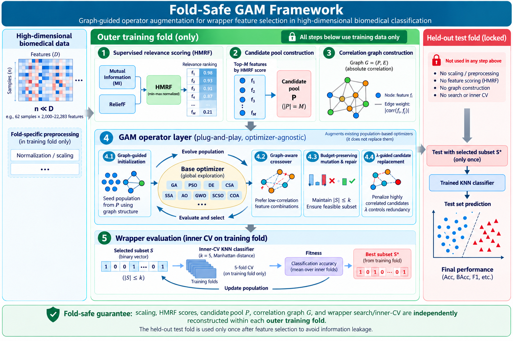

# Graph-Augmented Metaheuristic (GAM)

> **A Fold-Safe Plug-and-Play Framework for Wrapper Feature Selection in High-Dimensional Biomedical Data**


[](https://doi.org/10.5281/zenodo.23855795)


---

## Graphical Abstract

<p align="center">
  
</p>

<p align="center">
  <em>Fold-safe graph-augmented operator framework for redundancy-aware wrapper feature selection.</em>
</p>

---

## Introduction

**GAM** (**Graph-Augmented Metaheuristic**) is a fold-safe, plug-and-play wrapper feature-selection framework for high-dimensional biomedical classification.

Instead of proposing another standalone optimizer, GAM augments existing metaheuristic searchers with fold-internal supervised guidance, an intra-fold feature-correlation graph, graph-guided operators, and a λ-controlled redundancy penalty. All supervised guidance is rebuilt within each training fold, preventing full-data scoring from leaking information into model selection.

This repository accompanies the manuscript submitted to **Applied Soft Computing**. It provides source code, processed benchmark datasets, raw experimental outputs, reproducibility scripts, and supplementary analyses.

---

## Highlights

- **Fold-safe protocol**: scaling, supervised scoring, candidate-pool construction, and graph construction are performed inside training folds.
- **Plug-and-play operator layer**: GAM can be attached to heterogeneous metaheuristic optimizers without replacing their core search rules.
- **Graph-guided search**: an intra-fold feature-correlation graph guides initialization, crossover, mutation, and repair.
- **Redundancy-aware penalty**: a λ-controlled operator-level penalty reduces redundant combinations within the GAM framework.
- **Broad validation**: experiments cover ablations, classical optimizers, recent searchers, external optimizers, filter baselines, binary wrappers, convergence behavior, large-dimensional settings, stability analysis, embedded baselines, multimetric endpoint robustness, and HMRF alpha sensitivity.

---

## Main Results Preview

| Metric | Bare | GAM-λ0 | GAM λ=0.6 |
|--------|-----:|-------:|----------:|
| Macro Accuracy | 0.7706 | 0.8179 | **0.8253** |
| Macro Redundancy (pairwise-zero) | 0.2130 | 0.2992 | **0.2685** |
| ΔRed vs GAM-λ0 | — | — | **−10.28%** |

GAM improves the macro-average fold-safe accuracy from **0.7706** to **0.8253**, corresponding to a **5.46 percentage-point gain** over Bare optimizers. Within the GAM framework, the λ-guided redundancy penalty reduces redundancy by **10.28%** relative to GAM-λ0 while preserving the same accuracy tier. These figures come from the fold-safe revalidation (see [Revalidation](#revalidation)); redundancy uses the pairwise-zero convention defined there, with finite-pair averages reported as a sensitivity check.

---

## Revalidation

The main benchmark and its supporting experiments were **revalidated** after a pre-submission code–data audit identified four implementation issues (SSA λ-invariance, a crossover wrapper that swallowed `gen`/`max_gen`, an AO/POA/TSO `gen=T` call, and a CSV first-row misread that dropped one sample per dataset). The fixes are applied in place in `code/` and `experiments/`, and the full revalidation pipeline lives in [`experiments/revalidation_v2/`](experiments/revalidation_v2/README.md), with raw results under [`results/revalidation_v2/`](results/revalidation_v2/).

The revalidation reruns 1873 main-queue tasks + 60 component tasks with **0 errors** and confirms the manuscript's conclusions:

| Test | Statistic |
|------|-----------|
| Friedman (Bare / GAM-λ0 / GAM) | χ² = 26.27, **p = 1.97 × 10⁻⁶** |
| Exact paired Wilcoxon, Bare vs GAM | **p = 6.1 × 10⁻⁵** |
| Exact paired Wilcoxon, GAM-λ0 vs GAM | **p = 0.0040** |

The accuracy gain (+5.46 pp Bare → GAM λ=0.6) and the λ-guided redundancy reduction (−10.28% relative to GAM-λ0) are both reproduced; only the redundancy absolute values shift slightly because the legacy definition (which zeroed the whole-subset mean when any pair was undefined) was replaced by the pairwise-zero convention (undefined pairs are zeroed individually). Finite-pair averages are reported separately as a sensitivity check.

The revalidation also replaces the old coarse three-arm ablation (`Bare` / `GAM-λ0` / `GAM`) with a **finer component ablation** that isolates each GAM mechanism on the *same* GA backbone — the earlier ablation compared distinct backbones, so it could not attribute the gain to any single component:

| Group | Components | Accuracy | Redundancy |
|-------|-----------|---------:|-----------:|
| A | uniform init + random crossover | 0.7212 | 0.2463 |
| B | + HMRF top-pool init | 0.7478 | 0.2704 |
| C | + relevance-guided crossover (λ=0) | 0.7601 | 0.2768 |
| D | + λ=0.6 penalty | 0.7719 | 0.2675 |

The gain is driven primarily by **HMRF-guided initialization** (A→B ≈ +2.7 pp); the relevance-guided crossover (+1.2 pp) and the λ penalty (+1.2 pp) contribute less, with λ's main effect being the redundancy reduction (C→D). See [`experiments/revalidation_v2/component_ablation.py`](experiments/revalidation_v2/component_ablation.py).

---

## Additional Supplementary Analyses

| Analysis | Main purpose | Output file |
|----------|--------------|-------------|
| Convergence monitoring | Inspect search dynamics and inner-CV fitness trajectories | `results/bench_convergence.jsonl` |
| Jaccard selected-subset stability | Measure reproducibility of selected feature subsets across folds and runs | `results/bench_jaccard_stability_primary.jsonl` |
| Embedded baselines | Boundary comparison with LASSO, Elastic Net, and Random Forest feature importance | `results/bench_embedded_baselines.jsonl` |
| Multimetric endpoint robustness | Check accuracy, balanced accuracy, macro-F1, and weighted-F1 under the same fold-safe wrapper logic | `results/bench_multimetric_robustness_primary.jsonl` |
| HMRF alpha sensitivity | Evaluate whether the fixed MI/ReliefF mixing weight is a fragile design choice | `results/bench_alpha_sensitivity_merged_5proc.jsonl` |
| Fold-safe vs full-data leakage diagnostic | Quantify the optimism from building scaler/HMRF/graph on the full dataset instead of the outer training fold | `results/leakage_diagnostic_v2/` |

### Jaccard stability preview

Stability is assessed from the primary GA selected subsets across all 15 datasets. Each dataset–configuration pair has 25 subsets from 5 runs × 5 folds, giving C(25,2)=300 subset pairs per dataset/configuration.

| Method | Macro Jaccard stability |
|--------|------------------------:|
| Bare-GA | 0.0310 |
| GAM-λ0 | 0.1594 |
| GAM λ=0.6 | **0.1816** |

The stability analysis shows that GAM produces substantially more reproducible selected subsets than Bare-GA across the 15-dataset primary benchmark.

### Multimetric endpoint robustness preview

Secondary endpoints are computed from the same outer-test predictions as the 15-dataset primary benchmark. The wrapper fitness remains inner-CV KNN accuracy, while balanced accuracy, macro-F1, and weighted-F1 are evaluation endpoints only.

| Metric | Bare | Full GAM | Δ | W/L/T | Wilcoxon p |
|--------|-----:|---------:|--:|:-----:|-----------:|
| Accuracy | 0.7706 | **0.8253** | +0.0546 | 15/0/0 | 6.1 × 10⁻⁵ |
| Balanced accuracy | 0.7251 | **0.7971** | +0.0720 | 15/0/0 | 6.1 × 10⁻⁵ |
| Macro-F1 | 0.7140 | **0.7869** | +0.0729 | 15/0/0 | 6.1 × 10⁻⁵ |
| Weighted-F1 | 0.7536 | **0.8118** | +0.0582 | 15/0/0 | 6.1 × 10⁻⁵ |

This analysis reuses the primary predictions: balanced accuracy and macro-F1 gain 7.20 and 7.29 percentage points, confirming the GAM gain is not limited to raw accuracy. It is reported as supplementary evidence rather than as a replacement for the primary benchmark.

### HMRF alpha sensitivity preview

The primary experiments use equal MI/ReliefF weighting (`alpha=0.5`) as a pre-specified default. The supplementary alpha analysis evaluates `alpha ∈ {0.2, 0.4, 0.5, 0.6, 0.8}` on colon, DLBCL, and 9_Tumors using GAM-GA under a fold-safe 5-fold, 3-run protocol.

| Alpha | Accuracy | Balanced Acc | Macro-F1 | Redundancy |
|------:|---------:|-------------:|---------:|-----------:|
| 0.2 | 0.7471 | 0.7290 | 0.7003 | 0.2571 |
| 0.4 | 0.7556 | 0.7441 | 0.7175 | 0.2643 |
| 0.5 | 0.7646 | 0.7514 | 0.7259 | 0.2668 |
| 0.6 | **0.7789** | **0.7715** | **0.7445** | 0.2637 |
| 0.8 | 0.7777 | 0.7719 | 0.7418 | 0.2647 |

These results should not be used to retune the main benchmark. They show that HMRF weighting is not a single-point artifact and that mid-to-high MI weights (`alpha=0.6-0.8`) are promising for future adaptive weighting.

### Embedded baseline preview

Representative embedded feature-selection baselines are evaluated under the same fold-safe top-k KNN protocol on 7 datasets. The GAM λ=0.6 column is the same-dataset macro reference from the main benchmark.

| Method | Macro Accuracy |
|--------|---------------:|
| LASSO | 0.7447 |
| Elastic Net | 0.7968 |
| Random Forest | 0.7944 |
| GAM λ=0.6 (E2 reference) | **0.8136** |

GAM λ=0.6 retains a clear margin over the embedded baselines (+1.68 pp over Elastic Net, +1.92 pp over Random Forest, +6.89 pp over LASSO) under fixed-k accuracy evaluation. These baselines are reported as supplementary boundary comparisons: they are competitive, but they do not provide optimizer-agnostic graph-guided variation operators or explicit redundancy-aware wrapper search.

---

## Supported Optimizers

| Category | Algorithms |
|----------|------------|
| Classical evolutionary / swarm optimizers | GA, CSA, SSA, PSO, DE |
| External SOTA optimizers | AO, GWO |
| Recent metaheuristic searchers | SCSO, COA |
| Independent binary wrapper baselines | BGWO, BPSO |

---

## Experimental Matrix

| Experiment | Purpose | Main output |
|-----------|---------|-------------|
| E1 Bare ablation | Native optimizers without HMRF/graph/λ (superseded by the finer per-component ablation in [Revalidation](#revalidation)) | `bench_foldsafe_bare.jsonl` |
| E2 Main GAM benchmark | GAM-λ0 vs GAM λ=0.6 under fold-safe protocol | `bench_foldsafe_full.jsonl` |
| E3 λ sensitivity | Robustness of λ=0.6 across representative datasets and base optimizers | `bench_lambda_sensitivity.jsonl` |
| E4 External optimizer transfer | AO/GWO external validation | `bench_foldsafe_sota.jsonl` |
| E5 Recent searcher transfer | SCSO/COA transfer validation | `bench_recent_searchers.jsonl` |
| E6 Filter baselines | MI, ReliefF, mRMR, and F-score boundary baselines | `bench_foldsafe_filter.jsonl` |
| E7 Large-dimensional feasibility | Feasibility under high-dimensional limited-budget setting | `bench_foldsafe_large_optimized.jsonl` |
| E8 Independent wrappers | BGWO/BPSO/GAM-GA comparison | `bench_independent_wrappers.jsonl` |
| E9 Multimetric endpoint robustness | Accuracy, balanced accuracy, macro-F1, and weighted-F1 | `bench_multimetric_robustness_primary.jsonl` |
| E10 HMRF alpha sensitivity | Sensitivity of the MI/ReliefF mixing weight | `bench_alpha_sensitivity_merged_5proc.jsonl` |
| Supplementary convergence | Search-process behavior | `bench_convergence.jsonl` |
| Supplementary stability | Selected-subset reproducibility across folds and runs | `bench_jaccard_stability_primary.jsonl` |
| Supplementary embedded baselines | LASSO, Elastic Net, and Random Forest boundary baselines | `bench_embedded_baselines.jsonl` |

---

## Repository Structure

```text
GAM-Feature-Selection/
├── README.md
├── LICENSE
├── requirements.txt
├── .gitignore
│
├── code/
│   ├── bench_gam.py
│   ├── bench_bare.py
│   └── bench_gam_sota.py
│
├── data/
│   ├── colon(62,2000).csv
│   ├── DLBCL(77,5469).csv
│   ├── arcene(200,10000).csv
│   └── ... (16 processed benchmark CSVs)
│
├── docs/
│   ├── EXPERIMENT_DATA.md
│   └── graphical_abstract.png
│
├── experiments/
│   ├── verify_crossover_equivalence.py   # new/old crossover equivalence test
│   ├── run_large_scale.py                # E7
│   ├── run_multimetric_robustness.py     # E9
│   ├── run_alpha_sensitivity.py          # E10
│   ├── run_jaccard_stability.py
│   ├── run_embedded_baselines.py
│   ├── run_bare.py
│   ├── run_convergence.py
│   ├── run_ablation.py
│   ├── run_external_baselines.py
│   ├── run_filter_baselines.py
│   ├── run_filter_wrapper.py
│   ├── run_independent_wrappers.py
│   ├── run_lambda_large.py
│   ├── run_lambda_sensitivity.py
│   ├── run_recent_searchers.py
│   ├── run_sota_large.py
│   ├── rerun_residual_large.py
│   ├── rerun_sota_foldsafe.py
│   ├── patch_dlbcl_gwo.py
│   ├── analyze_ablation.py
│   ├── analyze_alpha_sensitivity.py
│   ├── analyze_bare.py
│   ├── analyze_multimetric_robustness.py
│   └── ...
│
├── results/
│   ├── bench_foldsafe_full.jsonl
│   ├── bench_foldsafe_bare.jsonl
│   ├── bench_lambda_sensitivity.jsonl
│   ├── bench_foldsafe_sota.jsonl
│   ├── bench_foldsafe_filter.jsonl
│   ├── bench_foldsafe_large_optimized.jsonl
│   ├── bench_convergence.jsonl
│   ├── bench_filter_guided_gam.jsonl
│   ├── bench_independent_wrappers.jsonl
│   ├── bench_recent_searchers.jsonl
│   ├── bench_multimetric_robustness_primary.jsonl
│   ├── bench_phase_breakdown.jsonl
│   ├── bench_alpha_sensitivity_shard_*_of_5.jsonl
│   ├── bench_jaccard_stability_primary.jsonl
│   └── bench_embedded_baselines.jsonl
│
└── utils/
    ├── Filter.py
    └── ReliefF.py
```

## Installation

```bash
git clone https://github.com/gicisky/GAM-Feature-Selection.git
cd GAM-Feature-Selection
pip install -r requirements.txt
```

Optional environment check:

```bash
python -c "import numpy, sklearn; print('Environment ready')"
```

---

## Running Supplementary Analyses

Selected-subset stability:

```bash
python experiments/run_jaccard_stability.py
```

Embedded feature-selection baselines:

```bash
python experiments/run_embedded_baselines.py
```

Multimetric endpoint robustness:

```bash
python experiments/run_multimetric_robustness.py
```

HMRF alpha sensitivity:

```bash
python experiments/run_alpha_sensitivity.py \
  --num-shards 5 --shard-index 0 --out results/bench_alpha_sensitivity_shard_0_of_5.jsonl
python experiments/analyze_alpha_sensitivity.py \
  --input 'results/bench_alpha_sensitivity_shard_*_of_5.jsonl' \
  --out-dir results/alpha_sensitivity_summary_5proc
```

---

## Datasets

The repository contains processed benchmark CSV files for reproducibility. These datasets originate from public biomedical repositories and widely used feature-selection benchmark collections.

Representative datasets include:

| Dataset | Samples | Features |
|---------|--------:|---------:|
| colon | 62 | 2,000 |
| SRBCT | 83 | 2,308 |
| Leukemia1 | 72 | 5,327 |
| DLBCL | 77 | 5,469 |
| 9_Tumors | 60 | 5,726 |
| Brain_Tumor1 | 90 | 5,920 |
| arcene | 200 | 10,000 |
| Brain_Tumor_2 | 50 | 10,368 |
| Lung | 202 | 12,601 |
| Prostate | 102 | 12,600 |
| CrohnDisease | 127 | 22,283 |

Users should refer to the paper for the original data sources and citations.

---

## Fold-Safe Protocol

For each outer fold:

1. Fit the scaler on the outer training set only.
2. Compute MI and ReliefF scores only on the outer training set.
3. Construct the feature-correlation graph only from the outer training set.
4. Run wrapper search using inner cross-validation on the outer training set.
5. Evaluate the selected subset on the held-out outer test fold.

This protocol prevents full-data supervised scoring from inflating performance estimates.

---

## Reproducibility Notes

The full benchmark is computationally intensive. Users can reproduce any experiment via the corresponding `experiments/run_*.py` script (see the Experimental Matrix). Raw result files used in the manuscript are provided in `results/`.

The supplementary scripts are provided for transparency, robustness checks, and boundary analysis. They should not be interpreted as replacing the full fold-safe benchmark reported in the manuscript. In particular, multimetric endpoints and HMRF alpha sensitivity are reported as supplementary checks rather than as new optimization objectives or post-hoc retuning evidence.

---

## Citation

If you find this repository useful, please cite:

```bibtex
@article{Ma2026GAM,
  title   = {Fold-Safe Graph-Augmented Metaheuristic Feature Selection with Redundancy-Aware Operators for High-Dimensional Biomedical Classification},
  author  = {Ma, Qinwei and Zhang, Pengyi and Chen, Kansong},
  journal = {Applied Soft Computing},
  year    = {2026},
  note    = {Submitted},
  url     = {https://github.com/gicisky/GAM-Feature-Selection}
}
```

---

## License

This project is released under the MIT License. See [`LICENSE`](LICENSE) for details.

---

## Contact

**Qinwei Ma**  
School of Computer Science, Hubei University  
Email: mqw@stu.hubu.edu.cn

If you encounter any issue, please open an issue in this repository.
