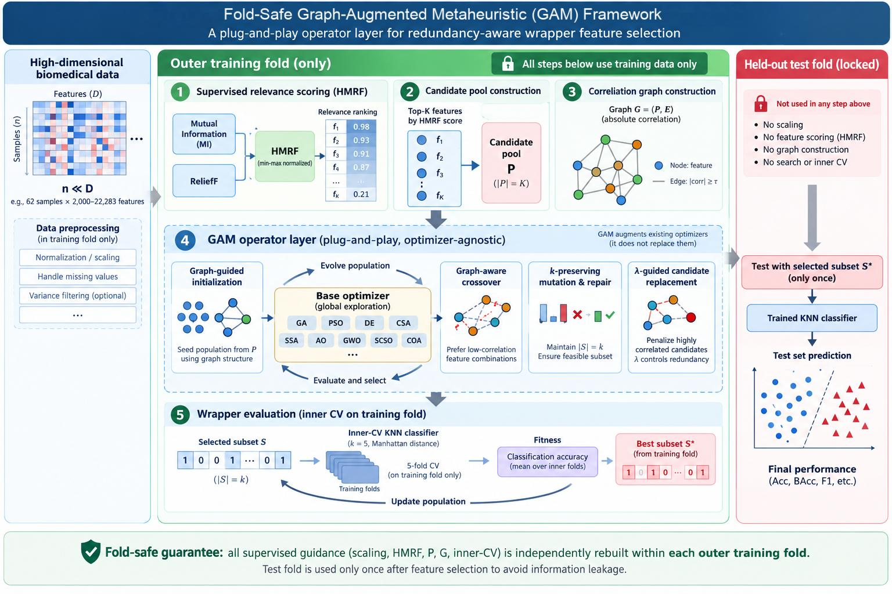

# Graph-Augmented Metaheuristic (GAM)

> **A Fold-Safe Plug-and-Play Framework for Wrapper Feature Selection in High-Dimensional Biomedical Data**


---

## Graphical Abstract

<p align="center">
  
</p>

<p align="center">
  <em>Fold-safe graph-augmented operator framework for redundancy-aware wrapper feature selection.</em>
</p>

---

## Introduction

**GAM** (**Graph-Augmented Metaheuristic**) is a fold-safe, plug-and-play wrapper feature-selection framework for high-dimensional biomedical classification.

Instead of proposing another standalone optimizer, GAM augments existing metaheuristic searchers with fold-internal supervised guidance, an intra-fold feature-correlation graph, graph-guided operators, and a λ-controlled redundancy penalty. All supervised guidance is rebuilt within each training fold, preventing full-data scoring from leaking information into model selection.

This repository accompanies the manuscript submitted to **Applied Soft Computing**. It provides source code, processed benchmark datasets, raw experimental outputs, reproducibility scripts, and supplementary analyses.

---

## Highlights

- **Fold-safe protocol**: scaling, supervised scoring, candidate-pool construction, and graph construction are performed inside training folds.
- **Plug-and-play operator layer**: GAM can be attached to heterogeneous metaheuristic optimizers without replacing their core search rules.
- **Graph-guided search**: an intra-fold feature-correlation graph guides initialization, crossover, mutation, and repair.
- **Redundancy-aware penalty**: a λ-controlled operator-level penalty reduces redundant combinations within the GAM framework.
- **Broad validation**: experiments cover ablations, classical optimizers, recent searchers, SOTA optimizers, filter baselines, binary wrappers, convergence behavior, large-dimensional settings, stability analysis, and embedded baselines.

---

## Main Results Preview

| Metric | Bare | GAM-λ0 | GAM λ=0.6 |
|--------|-----:|-------:|----------:|
| Macro Accuracy | 0.7672 | 0.8187 | **0.8236** |
| Macro Redundancy | 0.2036 | 0.2967 | **0.2660** |
| ΔRed vs GAM-λ0 | — | — | **−10.33%** |

GAM improves the macro-average fold-safe accuracy from **0.7672** to **0.8236**, corresponding to a **5.64 percentage-point gain** over Bare optimizers. Within the GAM framework, the λ-guided redundancy penalty reduces redundancy by **10.33%** relative to GAM-λ0 while preserving the same accuracy tier.

---

## Additional Supplementary Analyses

| Analysis | Main purpose | Output file |
|----------|--------------|-------------|
| Minimal reproducible demo | Verify installation and fold-safe workflow | terminal output |
| Jaccard selected-subset stability | Measure reproducibility of selected feature subsets across folds and runs | `results/bench_jaccard_stability_summary.jsonl` |
| Embedded baselines | Boundary comparison with LASSO, Elastic Net, and Random Forest feature importance | `results/bench_embedded_baselines_summary.jsonl` |
| MI/VIF diagnostics | Exploratory redundancy diagnostics; not used as primary evidence | `results/bench_recent_mi_vif.jsonl` |

### Jaccard stability preview

For 5 monitored datasets, each method produced 25 selected subsets from 5 runs × 5 folds, giving C(25,2)=300 subset pairs per dataset/method.

| Method | Macro Jaccard stability |
|--------|------------------------:|
| Bare-GA | 0.0209 |
| GAM-λ0 | 0.1184 |
| GAM λ=0.6 | **0.1273** |

The stability analysis shows that GAM produces substantially more reproducible selected subsets than Bare-GA on the monitored datasets.

### Embedded baseline preview

Representative embedded feature-selection baselines are evaluated under the same fold-safe top-k KNN protocol.

| Method | Macro Accuracy |
|--------|---------------:|
| LASSO | 0.7726 |
| Elastic Net | **0.7927** |
| Random Forest | 0.7871 |

These baselines are reported as supplementary boundary comparisons. They are competitive under fixed-k accuracy evaluation, but they do not provide optimizer-agnostic graph-guided variation operators or explicit redundancy-aware wrapper search.

---

## Supported Optimizers

| Category | Algorithms |
|----------|------------|
| Classical evolutionary / swarm optimizers | GA, CSA, SSA, PSO, DE |
| External SOTA optimizers | AO, GWO |
| Recent metaheuristic searchers | SCSO, COA |
| Independent binary wrapper baselines | BGWO, BPSO |

---

## Experimental Matrix

| Experiment | Purpose | Main output |
|-----------|---------|-------------|
| E1 Bare ablation | Native optimizers without HMRF/graph/λ | `bench_foldsafe_bare.jsonl` |
| E2 Main GAM benchmark | GAM-λ0 vs GAM λ=0.6 under fold-safe protocol | `bench_foldsafe_full.jsonl` |
| E3 λ sensitivity | Robustness of λ across datasets and base optimizers | `bench_lambda_sensitivity.jsonl` |
| E4 SOTA comparison | AO/GWO external validation | `bench_foldsafe_sota.jsonl` |
| E5 Filter baselines | MI, ReliefF, mRMR, and F-score baselines | `bench_foldsafe_filter.jsonl` |
| E6 Large-scale evaluation | Feasibility under high-dimensional limited-budget setting | `bench_foldsafe_large.jsonl` |
| E7 Convergence analysis | Search-process behavior | `bench_convergence.jsonl` |
| E8 Filter-guided GAM variants | Scoring-signal ablation | `bench_filter_guided_gam.jsonl` |
| E9 Independent wrappers | BGWO/BPSO/GAM-GA comparison | `bench_independent_wrappers.jsonl` |
| E10 Recent searchers | SCSO/COA transfer validation | `bench_recent_searchers.jsonl` |
| E11 Jaccard stability | Selected-subset reproducibility across folds and runs | `bench_jaccard_stability_summary.jsonl` |
| E12 Embedded baselines | LASSO, Elastic Net, and Random Forest boundary baselines | `bench_embedded_baselines_summary.jsonl` |

---

## Repository Structure

```text
GAM-Feature-Selection/
├── README.md
├── LICENSE
├── requirements.txt
│
├── code/
│   ├── bench_gam.py
│   ├── bench_bare.py
│   └── bench_gam_sota.py
│
├── data/
│   ├── colon(62,2000).csv
│   ├── DLBCL(77,5469).csv
│   ├── arcene(200,10000).csv
│   └── ...
│
├── docs/
│   ├── EXPERIMENT_DATA.md
│   ├── DATASETS.md
│   └── FIGURES/
│       └── graphical_abstract.png
│
├── experiments/
│   ├── run_demo.py
│   ├── run_jaccard_stability.py
│   ├── run_embedded_baselines.py
│   ├── run_mi_vif.py
│   ├── run_bare.py
│   ├── analyze_ablation.py
│   ├── rerun_sota_foldsafe.py
│   └── ...
│
├── results/
│   ├── bench_foldsafe_full.jsonl
│   ├── bench_foldsafe_bare.jsonl
│   ├── bench_lambda_sensitivity.jsonl
│   ├── bench_foldsafe_sota.jsonl
│   ├── bench_foldsafe_filter.jsonl
│   ├── bench_foldsafe_large.jsonl
│   ├── bench_convergence.jsonl
│   ├── bench_filter_guided_gam.jsonl
│   ├── bench_independent_wrappers.jsonl
│   ├── bench_recent_searchers.jsonl
│   ├── bench_jaccard_stability_summary.jsonl
│   └── bench_embedded_baselines_summary.jsonl
│
└── utils/
    ├── Filter.py
    └── ReliefF.py
```

---

## Installation

```bash
git clone https://github.com/gicisky/GAM-Feature-Selection.git
cd GAM-Feature-Selection
pip install -r requirements.txt
```

Optional environment check:

```bash
python -c "import numpy, sklearn; print('Environment ready')"
```

---

## Minimal Reproducible Demo

Run a lightweight workflow-verification demo:

```bash
python experiments/run_demo.py
```

The default demo runs a reduced fold-safe GAM workflow on the colon dataset using GA and a lightweight search budget. It is intended for installation and pipeline verification only; paper-level claims are based on the full benchmark reported in the manuscript.

A typical full-demo run on the colon dataset illustrates the expected mechanism:

| Method | Accuracy | Redundancy |
|--------|---------:|-----------:|
| Bare-GA | 0.7325 | 0.3775 |
| GAM-λ0 | 0.7868 | 0.3699 |
| GAM λ=0.6 | 0.7709 | 0.3404 |

The demo shows the intended three-level behavior: GAM-λ0 improves search quality over Bare-GA, while GAM λ=0.6 reduces redundancy within the GAM framework. Exact numbers may vary slightly across machines, package versions, and random seeds.

For a more stable but slower demonstration, use the optional full-demo setting if available:

```bash
python experiments/run_demo.py --full-demo
```

---

## Running Supplementary Analyses

Selected-subset stability:

```bash
python experiments/run_jaccard_stability.py
```

Embedded feature-selection baselines:

```bash
python experiments/run_embedded_baselines.py
```

Exploratory MI/VIF diagnostics:

```bash
python experiments/run_mi_vif.py
```

The MI/VIF script is provided for diagnostic transparency. Pairwise MI and VIF are not used as primary manuscript evidence because they capture different dependence structures and VIF is often invalid in p ≥ n high-dimensional folds.

---

## Datasets

The repository contains processed benchmark CSV files for reproducibility. These datasets originate from public biomedical repositories and widely used feature-selection benchmark collections.

Representative datasets include:

| Dataset | Samples | Features |
|---------|--------:|---------:|
| colon | 62 | 2,000 |
| SRBCT | 83 | 2,308 |
| Leukemia1 | 72 | 5,327 |
| DLBCL | 77 | 5,469 |
| 9_Tumors | 60 | 5,726 |
| Brain_Tumor1 | 90 | 5,920 |
| arcene | 200 | 10,000 |
| Brain_Tumor_2 | 49 | 10,368 |
| Lung | 202 | 12,601 |
| Prostate | 102 | 12,600 |
| CrohnDisease | 127 | 22,283 |

Users should refer to `docs/DATASETS.md` or the paper for the original data sources and citations.

---

## Fold-Safe Protocol

For each outer fold:

1. Fit the scaler on the outer training set only.
2. Compute MI and ReliefF scores only on the outer training set.
3. Construct the feature-correlation graph only from the outer training set.
4. Run wrapper search using inner cross-validation on the outer training set.
5. Evaluate the selected subset on the held-out outer test fold.

This protocol prevents full-data supervised scoring from inflating performance estimates.

---

## Reproducibility Notes

The full benchmark is computationally intensive. Users are encouraged to first run `experiments/run_demo.py` to verify the environment and workflow. Raw result files used in the manuscript are provided in `results/`.

The supplementary scripts are provided for transparency and boundary analysis. They should not be interpreted as replacing the full fold-safe benchmark reported in the manuscript.

---

## Citation

If you find this repository useful, please cite:

```bibtex
@article{Ma2026GAM,
  title   = {Graph-Augmented Metaheuristic Framework for Wrapper Feature Selection},
  author  = {Ma, Qinwei and Zhang, Pengyi and Chen, Kansong},
  journal = {Applied Soft Computing},
  year    = {2026},
  note    = {Submitted},
  url     = {https://github.com/gicisky/GAM-Feature-Selection}
}
```

---

## License

This project is released under the MIT License. See [`LICENSE`](LICENSE) for details.

---

## Contact

**Qinwei Ma**  
School of Computer Science, Hubei University  
Email: mqw@stu.hubu.edu.cn

If you encounter any issue, please open an issue in this repository.
